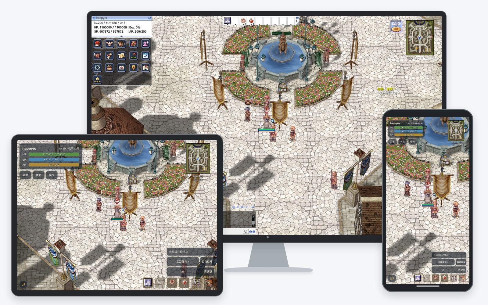
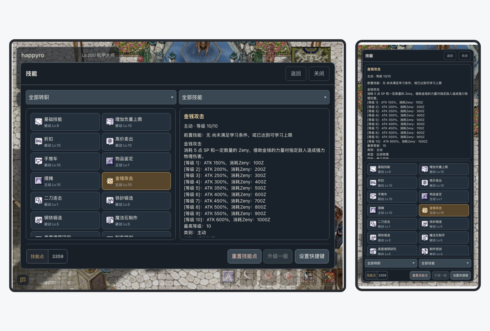
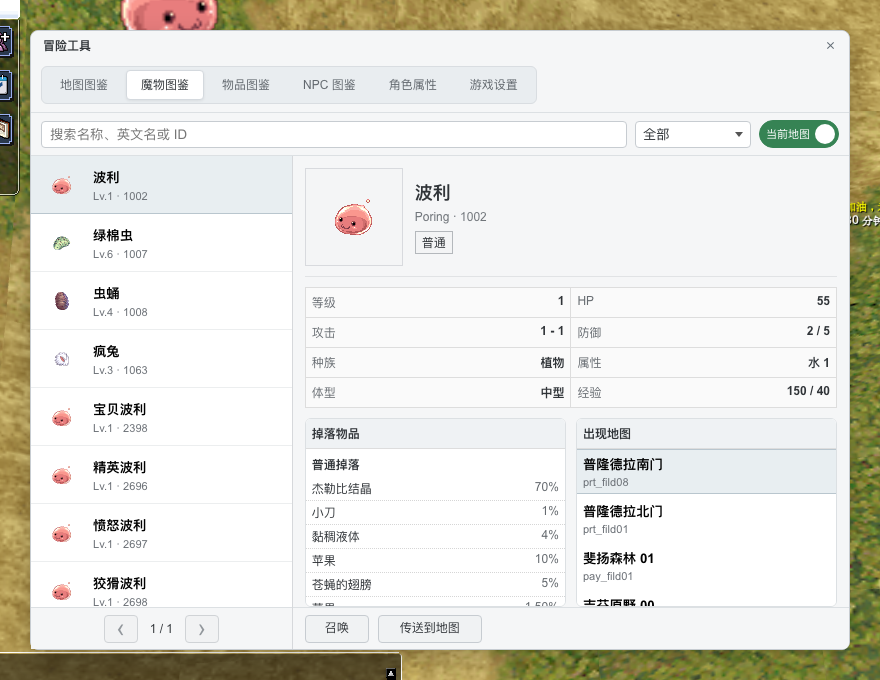
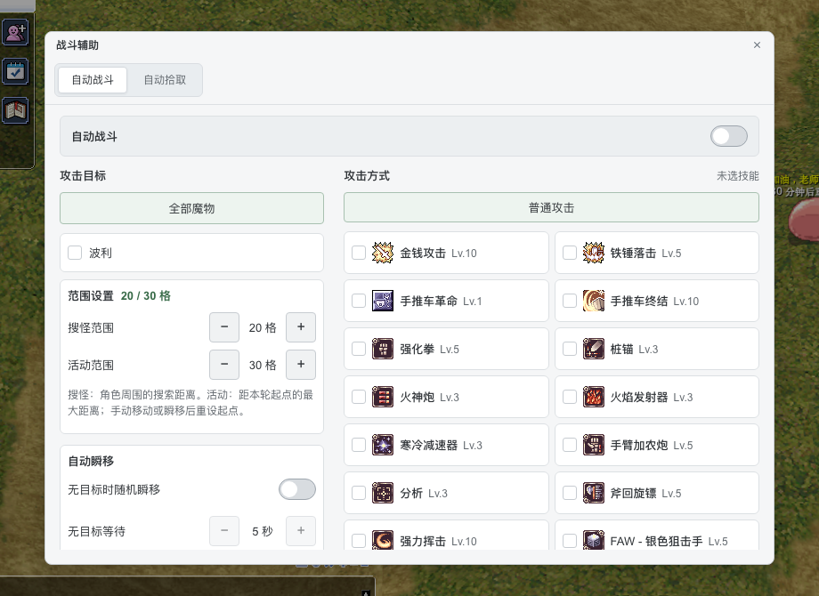
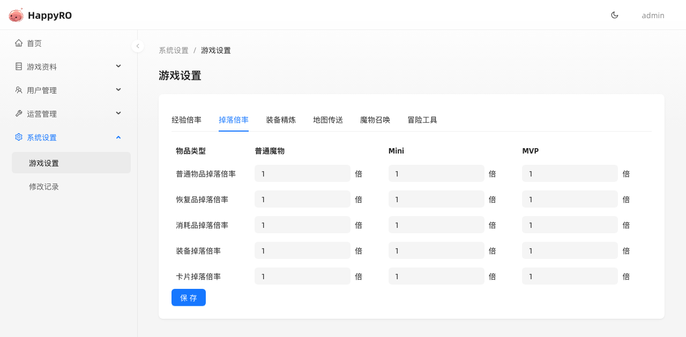

<h1>HappyRO</h1>

在电脑、平板和手机浏览器中冒险

基于 roBrowserLegacy 与 rAthena 的开源中文《仙境传说 Online》Web 项目

  <a href="https://happyro-demo.kugarocks.com/applications/pwa/index.html">游戏演示</a> ·
  <a href="https://happyro-admin.kugarocks.com">后台演示</a> ·
  <a href="https://happyro.kugarocks.com/guide/downloads">资源下载</a> ·
  <a href="https://happyro.kugarocks.com/guide/introduction">项目文档</a> ·
  <a href="https://happyro.kugarocks.com/container/docker">Docker 安装</a>

HappyRO 将经典 RO 带到浏览器，提供中文游戏界面、触屏操作、游戏图鉴与冒险工具，并配备独立管理后台和双架构离线部署包。中文内容覆盖物品、技能、魔物、地图、系统消息与 NPC 对话，翻译范围与已知限制见[关于汉化](https://happyro.kugarocks.com/guide/localization)。

> 本页按当前主分支介绍，截图来自本机游戏与后台；三端画面使用对应浏览器视口截取。当前开发版本为 [v0.5.0（未发布）](changelog/releases/v0.5.0.md)，公开已发布版本为 [v0.3.2](changelog/releases/v0.3.2.md)，离线包功能以对应发布说明为准。

## 触屏与跨端体验

电脑使用桌面界面，手机和平板提供触屏布局，支持横竖屏切换。拖动移动、点按交谈与拾取、六格分页快捷栏，以及背包、技能、社交等常用窗口，都围绕触屏操作适配。

通过 HTTPS 启动页可添加 PWA 到桌面。保持登录后重新打开进入选角，页面内意外断线可尝试恢复原角色；手机后台与页面回收的行为边界见[手机平板指南](https://happyro.kugarocks.com/game/mobile)。

## 图鉴与冒险工具

在游戏内查询物品属性与掉落来源、魔物资料与出现地图、NPC 位置及地图路线，并使用当前地图自动寻路。电脑、手机和平板均可打开冒险工具。

角色调整、物品与 Zeny 发放、魔物召唤、地图传送和游戏倍率设置按账号权限与服务器配置开放。详细功能见[图鉴与冒险工具](https://happyro.kugarocks.com/game/desktop)。

## 自动战斗与拾取

选择目标魔物、攻击技能和战斗范围，按物品类别与排除清单配置自动拾取。桌面与触屏端共用战斗逻辑，手动移动时暂停攻击，停止移动后继续。

支持无目标时随机传送，不支持全地图巡逻。配置方式与适用范围见[战斗与拾取](https://happyro.kugarocks.com/game/combat)。

## 独立管理后台

HappyRO Admin 提供账号与角色查询、物品与 Zeny 发放，以及经验、掉落、精炼和冒险工具权限等游戏设置。管理操作集中在独立 Web 后台，方便服主管理自己的服务器。

职业外观、宠物与生命体、组队与公会、交易与摆摊等更多玩法，见[玩家指南](https://happyro.kugarocks.com/game/desktop)与[职业外观及随行指南](https://happyro.kugarocks.com/game/companions)。

## 安装与体验

可以先打开[游戏演示](https://happyro-demo.kugarocks.com/applications/pwa/index.html)或[后台演示](https://happyro-admin.kugarocks.com)体验，再部署自己的服务器。

推荐使用[离线包](https://happyro.kugarocks.com/guide/downloads)安装。包内包含 `linux/amd64` 与 `linux/arm64` 镜像、运行资源、配置模板和配套工具；准备 Docker Engine、Compose v2 与 Python 3.11+ 后，按照 [Docker 安装手册](https://happyro.kugarocks.com/container/docker)完成部署。

| 入口 | 内容 |
| --- | --- |
| [Docker 部署](https://happyro.kugarocks.com/container/docker) | 离线安装、首次启动与日常维护 |
| [升级与恢复](https://happyro.kugarocks.com/container/upgrade) | 数据保留、升级与回退 |
| [自定义功能](https://happyro.kugarocks.com/container/customization) | NPC、数据库与客户端资源定制 |
| [源码开发](docs/development/workflow/local-setup.md) | 依赖、资源准备、构建与本机服务 |

## 项目组成

HappyRO 由根仓库、四个应用仓库和一个公开文档仓库组成：

| 仓库 | 职责 |
| --- | --- |
| 当前根仓库 | 部署脚本、配置、本地化资源与发布编排 |
| [happyro-client](https://github.com/happyro/happyro-client) | 浏览器客户端、PWA 与游戏内冒险工具 |
| [happyro-server](https://github.com/happyro/happyro-server) | rAthena 游戏服务与 Web API |
| [happyro-gateway](https://github.com/happyro/happyro-gateway) | 静态资源、HTTP 与 WebSocket 网关 |
| [happyro-admin](https://github.com/happyro/happyro-admin) | 游戏管理后台与 Laravel API |
| [happyro-doc](https://github.com/happyro/happyro-doc) | 安装文档、玩家指南与公开文档站 |

游戏基线为 kRO 2021-11-05 资源、`PACKETVER=20211103` 与 Renewal。架构与开发维护说明见[项目文档](docs/README.md)。

## 文档与社区

- [项目站点](https://happyro.kugarocks.com) · [GitHub Pages](https://happyro.org)
- [更新日志](changelog/README.md) · [v0.5.0 发布准备与已知限制](changelog/releases/v0.5.0.md)
- QQ 群：`662191549`（HappyRO）

## 致谢与协议

HappyRO 基于 [roBrowserLegacy](https://github.com/MrAntares/roBrowserLegacy) 与 [rAthena](https://github.com/rathena/rathena) 构建，感谢上游项目及贡献者。

本项目采用 [GNU General Public License v3.0](LICENSE)。
