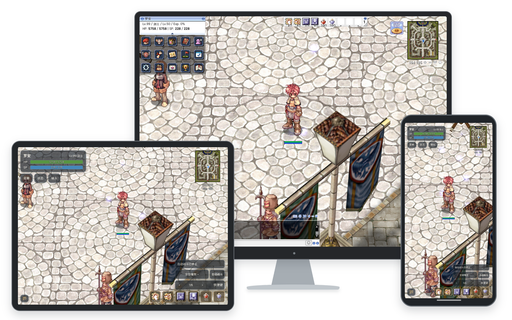
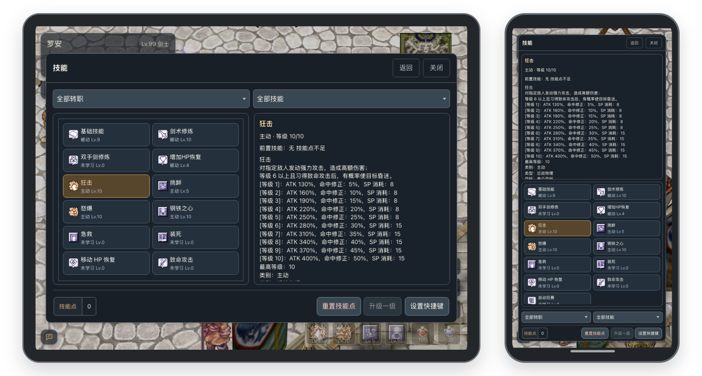

<h1>HappyRO</h1>

基于 roBrowserLegacy 与 rAthena 的开源中文《仙境传说 Online》Web 项目

  <a href="https://happyro-demo.kugarocks.com/applications/pwa/index.html">游戏演示</a> ·
  <a href="https://happyro-admin.kugarocks.com">后台演示</a> ·
  <a href="https://happyro.kugarocks.com/guide/downloads">资源下载</a> ·
  <a href="https://happyro.kugarocks.com/guide/introduction">项目文档</a> ·
  <a href="https://happyro.kugarocks.com/container/docker">Docker 安装</a>

HappyRO 是一个中文友好的网页端 RO 项目，提供中文游戏界面、触屏操作、游戏图鉴与冒险工具，并配备独立管理后台和双架构离线部署包。中文内容覆盖物品、技能、魔物、地图、系统消息与 NPC 对话，翻译范围与已知限制见[关于汉化](https://happyro.kugarocks.com/guide/localization)。

## 触屏与跨端体验

电脑端采用经典桌面界面，手机和平板分别针对屏幕尺寸与触控方式进行独立 UI 优化，支持横竖屏切换。移动端的拖动移动、点按交谈与拾取、六格分页快捷栏，以及背包、技能、社交等常用窗口均针对触屏操作进行适配。手机和平板还可通过启动页「分享 → 添加到主屏幕」，实现全屏效果。

## 图鉴与冒险工具

游戏内置完整的冒险工具，可查询物品属性与掉落来源、魔物资料与出现地图、NPC 位置及地图路线，并支持当前地图自动寻路。电脑、手机和平板均可使用。角色调整、物品与 Zeny 发放、魔物召唤、地图传送及游戏倍率设置等管理功能，则根据账号权限与服务器配置开放。

## 自动战斗与拾取

自动战斗支持指定目标魔物、攻击技能与战斗范围，并可按物品类别和排除清单设置自动拾取。桌面端与触屏端采用统一的战斗逻辑，手动移动时自动暂停攻击，停止移动后继续战斗；无可攻击目标时，还可启用随机传送。

## 管理后台

Web 管理后台提供账号与角色查询、物品与 Zeny 发放，以及经验、掉落、精炼和冒险工具权限等游戏配置功能，方便玩家管理服务器与游戏规则。

## 安装与体验

参考 [Docker 安装手册](https://happyro.kugarocks.com/container/docker)，下载[离线包](https://happyro.kugarocks.com/guide/downloads)，包内包含 `linux/amd64` 与 `linux/arm64` 镜像、运行资源、配置模板和配套工具。

| 入口 | 内容 |
| --- | --- |
| [Docker 部署](https://happyro.kugarocks.com/container/docker) | 离线安装、首次启动与日常维护 |
| [升级与恢复](https://happyro.kugarocks.com/container/upgrade) | 数据保留、升级与回退 |
| [自定义功能](https://happyro.kugarocks.com/container/customization) | NPC、数据库与客户端资源定制 |
| [源码开发](docs/development/workflow/local-setup.md) | 依赖、资源准备、构建与本机服务 |

## 项目组成

HappyRO 由根仓库、四个应用仓库和一个公开文档仓库组成：

| 仓库 | 职责 |
| --- | --- |
| 当前根仓库 | 部署脚本、配置、本地化资源与发布编排 |
| [happyro-client](https://github.com/happyro/happyro-client) | 浏览器客户端、PWA 与游戏内冒险工具 |
| [happyro-server](https://github.com/happyro/happyro-server) | rAthena 游戏服务与 Web API |
| [happyro-gateway](https://github.com/happyro/happyro-gateway) | 静态资源、HTTP 与 WebSocket 网关 |
| [happyro-admin](https://github.com/happyro/happyro-admin) | 游戏管理后台与 Laravel API |
| [happyro-doc](https://github.com/happyro/happyro-doc) | 安装文档、玩家指南与公开文档站 |

## 项目基线

| 项目 | 版本或基线 |
| --- | --- |
| kRO 客户端资源 | 2021-11-05（`RAG_SETUP_211105.exe`） |
| `PACKETVER` | `20211103` |
| 服务端模式 | Renewal |
| [rAthena](https://github.com/rathena/rathena) | `master` @ [`2fe6ab3dc4d8`](https://github.com/rathena/rathena/commit/2fe6ab3dc4d830b11d93fb44c3b48436571890bd) |
| [roBrowserLegacy](https://github.com/MrAntares/roBrowserLegacy) | `master` @ [`402e61ce7ae8`](https://github.com/MrAntares/roBrowserLegacy/commit/402e61ce7ae80cd45c76365371d4dbfd6aa10f49) |
| Node.js | 22 或更高版本 |
| MariaDB | 10.11 |
| LUB 工具链 | Lua 5.0.2、Lua 5.1.5 |

## 文档与社区

- [项目站点](https://happyro.kugarocks.com) · [GitHub Pages](https://happyro.org)
- [更新日志](changelog/README.md) · [v0.5.0 发布准备与已知限制](changelog/releases/v0.5.0.md)
- QQ 群：`662191549`（HappyRO）

## 开源协议

本项目采用 [GNU General Public License v3.0](LICENSE)。
